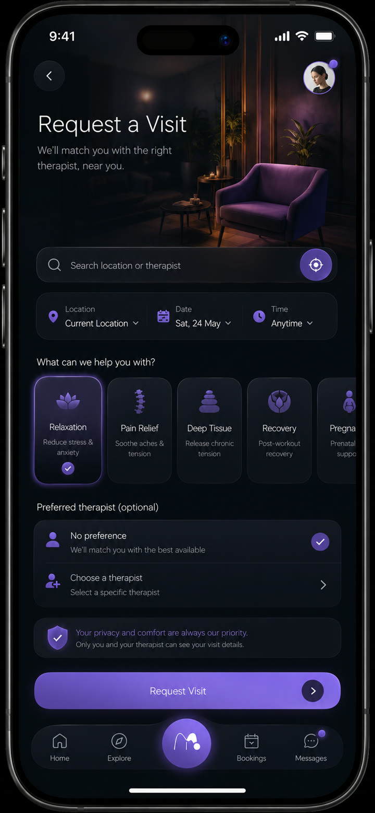

# Massera

**A marketplace for massage, spa, and wellness bookings**

Massera is designed to help people discover wellness services and arrange appointments with independent providers and spa teams. The product centers on the full booking journey, from finding a suitable service to managing the appointment afterward.

Its initial market focus is Nigeria, with the product structure designed to accommodate country and city configuration as the marketplace expands.

## Marketplace experiences

- **Clients** can discover therapists, compare service details, choose preferences, and arrange a visit.
- **Providers** can present their services and manage appointment-related work.
- **Spa teams** can coordinate services, schedules, and client interactions through dedicated workspaces.
- **Administrators** can support marketplace operations through a separate web console.

The planned customer journey includes service and provider discovery, profiles and reviews, location and availability selection, scheduling, booking details, checkout, notifications, and follow-up. A client can search by service or therapist, choose a time, and keep the appointment details in one place. Providers and spa teams need their own operational views so booking requests and service delivery do not depend on the client-facing screens.

## Mobile concept

  

Design concept from the project reference screens, not a production app capture.

## Engineering

The platform combines a Flutter mobile application, a Next.js administration experience, and Supabase-backed data and server workflows. The repository is organized into mobile and web apps, shared Flutter packages for design, models, validation, and Supabase access, plus database migrations and server functions.

Sensitive account, booking, payment, provider-verification, address, and administrative actions belong in trusted server-side workflows rather than in the client app. Payments for real-world services are treated as marketplace payments, distinct from digital subscription or in-app feature billing. Money amounts use minor units and are ledgered for reliable reconciliation.

## Technology

Flutter and Dart, Next.js, Supabase, PostgreSQL, shared Flutter packages, and server functions.

## This repository

This is a public product overview with one clearly labeled design concept. It does not include private source code, customer or booking records, credentials, or internal operating details.

[Explore AceNetics](https://acenetics.dev)
